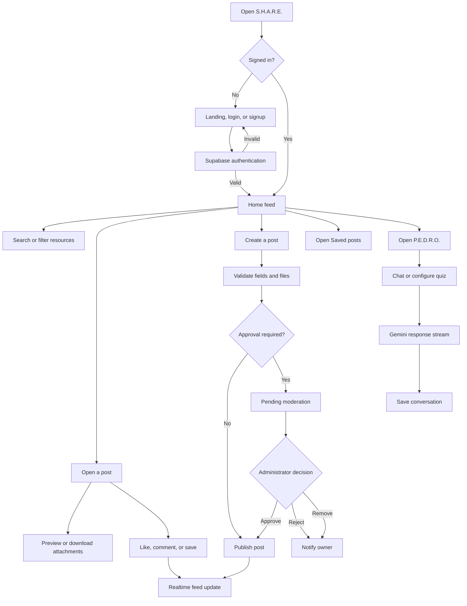
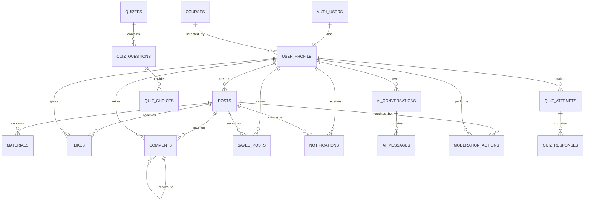

# Multimedia System Final Documentation

## Title of the System

**S.H.A.R.E. - Academic Resource Sharing and AI-Assisted Study Platform**

**Prepared by:** Torrechiva and Agramon  
**System version:** 0.58.0  
**Document status:** Review draft based on the implemented system  
**Date:** November 2026

> Screenshot note: The required screenshot positions are identified throughout the manual. Replace each placeholder with a current screenshot from the final deployed build before submission. Do not use screenshots containing passwords, API keys, access tokens, or private browser developer tools.

---

# 1.0 Introduction

S.H.A.R.E. is a web-based academic resource-sharing platform for students and instructors. It provides one place to publish notes and learning materials, browse resources shared by other users, interact through reactions and comments, save useful posts, and study with an AI assistant named P.E.D.R.O.

The completed application combines a responsive React interface, an Express server, Supabase authentication and database services, Supabase Storage for uploaded resources, and Google Gemini for AI-assisted study and quiz generation. The system runs on desktop and mobile browsers and includes account security, content moderation, notifications, document previews, and live feed updates.

## 1.1 Background of the System

Students often obtain notes by privately asking classmates, searching through several group chats, or guessing who may have a copy of a particular lesson. These methods make academic materials difficult to find and cause useful files to become scattered across different conversations and devices. Instructors also lack a focused channel for sharing learning materials while keeping student discussions connected to the resource itself.

S.H.A.R.E. addresses this problem through a searchable academic feed. Users can publish a resource once, classify it by subject, and make it available to the academic community. Other users can preview the material, react to it, comment on it, or save it for later. P.E.D.R.O. adds study assistance through conversational explanations and configurable practice quizzes.

### 1.1.1 Description of the Current System

The traditional process mainly relies on direct messages, class group chats, social-media posts, email attachments, and manual file transfers. A student who needs a specific note must know whom to ask or repeatedly search through unrelated messages. Files may be duplicated, renamed inconsistently, removed from temporary storage, or buried beneath later conversations.

The developed S.H.A.R.E. system replaces this fragmented process with the following working components:

- A centralized, searchable resource feed
- User accounts and editable academic profiles
- Persistent storage for uploaded resources
- Image, PDF, PowerPoint, video, and document support
- Reactions, comments, saved posts, and notifications
- Administrator approval and post moderation
- P.E.D.R.O. AI chat and quiz generation
- Live updates for posts, reactions, and comments
- Security controls for accounts, data ownership, files, and administrator actions

### 1.1.2 Problem Areas

The project responds to the following problems:

1. **Resource discovery.** Students cannot easily determine who has the material they need.
2. **Scattered files.** Academic resources are spread across private chats, social platforms, and local devices.
3. **Temporary storage.** Files stored only on a free application server may disappear when the service restarts or spins down.
4. **Limited context.** A file shared in a chat may be separated from the discussion about it.
5. **Unmoderated sharing.** A public academic platform needs controls for inappropriate, incorrect, or unwanted posts.
6. **Study support.** Students may possess a resource but still need help understanding it or preparing for an assessment.
7. **Mobile usability.** Students frequently use phones, requiring a responsive interface with touch-friendly controls.
8. **Privacy and ownership.** Users must not be able to modify another person's profile, post, conversation, notification, comment, reaction, or saved list.

## 1.2 Objectives of the System

### General Objective

To develop a secure and responsive academic platform that makes learning resources easier to publish, discover, discuss, save, and study.

### Specific Objectives

1. Provide account registration, login, recovery, and profile management.
2. Organize resources through searchable posts and subject filters.
3. Store uploaded files persistently through Supabase Storage.
4. Preview common academic file formats directly in the feed.
5. Support reactions, comments, saved posts, and live updates.
6. Notify users about post moderation and social activity.
7. Give administrators a protected interface for approving, rejecting, and removing posts.
8. Provide AI-assisted explanations and quiz generation through P.E.D.R.O.
9. Protect user data with server-side authorization and database Row Level Security.
10. Maintain a usable experience across desktop, tablet, and mobile screens.

## 1.3 Significance of the System

### Students

Students can find notes and academic files without first knowing which classmate has them. They can preview materials, join resource-specific discussions, save important posts, and request study assistance from P.E.D.R.O.

### Instructors

Instructors can distribute learning resources through a structured academic feed. Subject labels, attachment previews, and comments keep the material and its discussion in one location.

### Administrators

Administrators can review submissions, approve appropriate posts, reject or remove unsuitable content, manage administrator access, and retain an audit record of moderation actions.

### Academic Community

The platform encourages resource sharing while preserving ownership, access restrictions, and moderation. Realtime updates allow the community to see new posts and interactions without repeatedly refreshing the page.

### Future Developers and Researchers

The modular client, server, database policy scripts, tests, and deployment configuration provide a foundation for later improvements such as additional subjects, richer analytics, and institutional integrations.

---

# 2.0 The Proposed System

## 2.1 System Overview

The completed S.H.A.R.E. application uses a client-server architecture:

- **React and Vite** provide the web interface and production build.
- **Express** provides authenticated API routes, validation, rate limiting, file handling, and AI integration.
- **Supabase Auth** manages user identities and sessions.
- **Supabase PostgreSQL** stores profiles, posts, files, reactions, comments, notifications, conversations, saved posts, and moderation records.
- **Supabase Storage** stores post attachments and profile photographs.
- **Supabase Realtime** delivers live post, reaction, and comment changes.
- **Google Gemini** powers P.E.D.R.O. chat responses and quiz generation.
- **Optional Upstash Redis** caches frequently requested course data across server instances. A bounded in-memory cache acts as the fallback.

The application contains public landing, login, signup, and password recovery screens. Authenticated users gain access to the feed, post creation, post details, saved resources, profile settings, notifications, and P.E.D.R.O. Administrators receive an additional protected moderation area.

## 2.2 Process Specification

### Main User Process

1. The visitor opens the landing page.
2. The visitor creates an account or logs in.
3. The server verifies the Supabase access token.
4. The authenticated user enters the resource feed.
5. The user searches, filters, previews, reacts, comments, or saves a post.
6. The user may create a post with up to four attachments.
7. If approval is enabled, the new post enters the pending queue.
8. An administrator approves, rejects, or removes the post.
9. The system sends the owner a status notification.
10. Published posts appear in the feed and may receive realtime interactions.
11. The user may open P.E.D.R.O. for AI study assistance or a generated quiz.

### Authentication Process

The browser sends credentials to the server, and the server forwards valid requests to Supabase Auth. The browser receives session tokens only after a successful login. Protected API requests include the access token, which the server verifies before using the authenticated user ID for ownership checks. The interface alone never decides whether a user is an administrator.

### Resource Upload Process

The server checks the number, size, extension, MIME type, and actual file signature of each attachment. Valid files receive randomized storage names and are uploaded to the configured storage bucket. The database stores the original filename and storage path. If a database write fails, the server removes already uploaded files to avoid orphaned storage objects.

### Social Interaction Process

When a user likes or comments on a published post, the server verifies the session and checks that the target post remains published. The database prevents duplicate likes. The interface applies an immediate optimistic update, then confirms or reverses the change depending on the server response. Realtime subscriptions update other connected users.

### Moderation Process

New posts may be marked as pending. Administrators review the post and its attachments from the moderation page. Approval changes the status to published. Rejection or removal records a reason. A database trigger prevents ordinary users from changing moderation status, and the system records each administrator action.

### P.E.D.R.O. Process

The user sends a message or an accepted attachment. The server validates the request, enforces limits, and sends the normalized conversation to Gemini. Text arrives in the interface as a token stream. Conversations are automatically stored per user. Quiz generation validates the requested number of items, parts, question types, and returned JSON structure before displaying the quiz.

### 2.2.1 Flowchart of the System

### 2.2.2 Database Schema of the System

### Main Database Tables

| Table | Purpose |
|---|---|
| `user_profile` | Stores username, full name, role, avatar, year level, and course |
| `courses` | Stores active academic programs shown in profile settings |
| `posts` | Stores post text, subject, owner, moderation status, and timestamps |
| `materials` | Stores post attachment names, storage paths, types, and sizes |
| `likes` | Stores one reaction per user and post |
| `comments` | Stores post discussions and soft-deletion status |
| `saved_posts` | Stores each user's saved resources |
| `notifications` | Stores post-status and social-activity notifications |
| `ai_conversations` | Stores each user's P.E.D.R.O. conversation headers |
| `ai_messages` | Stores individual conversation messages |
| `moderation_actions` | Stores administrator decisions and reasons |
| `quizzes` and related tables | Support quiz structures, attempts, choices, and responses |

All user-owned tables use Row Level Security. Public feed queries expose only published posts and their permitted related records.

## 2.3 Software Requirements

### Development Requirements

| Component | Requirement |
|---|---|
| Operating system | Windows 10/11, macOS, or a current Linux distribution |
| Runtime | Node.js 24 or later |
| Package manager | npm |
| Frontend | React 19, Vite 8 |
| Server | Express 5 |
| Database and authentication | Supabase |
| File storage | Supabase Storage |
| AI provider | Google Gemini API |
| Source control | Git and a Git hosting service |
| Recommended editor | Visual Studio Code |

### End-User Requirements

- A current browser such as Chrome, Edge, Firefox, or Safari
- JavaScript and browser storage enabled
- Internet access for the deployed application, Supabase, and AI functions
- A valid account for protected features
- A display width of at least 320 pixels for the supported mobile layout

### Production Services

- Node-compatible web host such as Render
- Supabase project with Auth, PostgreSQL, Storage, and Realtime
- Gemini API key stored only on the server
- HTTPS-enabled public domain
- Optional Upstash Redis project for distributed caching

---

# 3.0 System Testing and Results

The current codebase was validated on November 8, 2026. The automated suite covers authentication, authorization, security headers, CORS, rate limiting, file validation, post ownership, Supabase persistence, reactions, comments, realtime behavior, P.E.D.R.O. streaming, quiz validation, timeouts, cleanup, production static serving, and real HTTP 404 responses.

## Testing Summary

| Test activity | Result | Notes |
|---|---:|---|
| ESLint code-quality check | Passed | No lint errors reported |
| Automated Node test suite | Passed | 57 of 57 tests passed |
| Production Vite build | Passed | 2,447 modules transformed successfully |
| Authentication validation | Passed | Missing, forged, and invalid sessions fail closed |
| Signup duplicate checks | Passed | Case-insensitive username, name, and email handling verified |
| Authorization and ownership | Passed | Protected routes derive identity from verified sessions |
| Post upload tests | Passed | Size, MIME type, extension, signature, cleanup, and ownership checked |
| Supabase post persistence | Passed | Database records and Storage paths preserved |
| Social interaction tests | Passed | Likes persist and comments enforce validation and ownership |
| Realtime update tests | Passed | Bursts are coalesced and reconnects reconcile state |
| AI request tests | Passed | Streaming, history limits, timeout, disconnect, and output bounds checked |
| Quiz response tests | Passed | Invalid or unsafe generated structures are rejected |
| Production routing tests | Passed | Only built assets are served and missing routes return 404 |

## Build Observations

The production build completed successfully. Vite reported size warnings for the lazily loaded PDF and PowerPoint rendering packages and their font or WebAssembly assets. These warnings do not stop deployment. The preview packages already load separately from the main feed bundle, but their large specialist assets remain an area for later optimization.

## Manual Acceptance Checklist

- [ ] Create and confirm a new account
- [ ] Log in and log out on desktop and mobile
- [ ] Recover and update a password
- [ ] Update profile details and upload an avatar
- [ ] Create text, image, PDF, PowerPoint, and multi-attachment posts
- [ ] Approve, reject, and remove a post using an administrator account
- [ ] Confirm the owner receives the corresponding notification
- [ ] Like and unlike a post from two accounts
- [ ] Add and delete a comment
- [ ] Save and unsave a post and confirm cross-device persistence
- [ ] Preview and download every supported attachment type
- [ ] Start, rename, reload, and delete a P.E.D.R.O. conversation
- [ ] Generate topic-based and file-based quizzes
- [ ] Verify live updates without manually refreshing the feed
- [ ] Verify unauthorized access to the administrator route returns the not-found screen

---

# 4.0 System Manual

## 4.1 General User

### 4.1.1 Opening the Website

1. Open the deployed S.H.A.R.E. URL in a supported browser.
2. Review the landing-page summary, benefits, process, and FAQ.
3. Select **Sign Up** for a new account or **Log In** for an existing account.
4. If already authenticated, select **Go to Home**.

> **Screenshot 1:** Public landing page showing the main S.H.A.R.E. message and account actions.

### 4.1.2 Registering an Account

1. Select **Sign Up**.
2. Enter a unique username and real full name.
3. Enter a valid email address.
4. Create a password containing 10 to 128 characters.
5. Repeat the password.
6. Select **Sign Up**.
7. If email confirmation is enabled, open the confirmation message before logging in.

The system rejects duplicate emails, usernames, and full names without treating letter case as a difference.

> **Screenshot 2:** Signup page with username, full name, email, password, and confirmation fields.

### 4.1.3 Logging In and Recovering a Password

1. Enter the registered email and password.
2. Optionally enable **Remember me**.
3. Select **Log In**.
4. To recover an account, enter the email and select **Forgot password?**
5. Follow the recovery link and choose a new password.

> **Screenshot 3:** Login page showing Remember me and Forgot password controls.

### 4.1.4 Navigating the Feed

1. Use the search bar to find notes, subjects, or topics.
2. Select a subject chip such as DSA, OOP, Discrete Math, OS, Syllabi, or General.
3. Scroll vertically through the posts.
4. Open **View all** to browse the complete category list.
5. Use the bottom navigation for the menu, home, or P.E.D.R.O.
6. While scrolling down, use the compact header for notifications, search, and profile access.

> **Screenshot 4:** Home feed with search, subject filters, attachment previews, and bottom navigation.

### 4.1.5 Creating a Post

1. Open the create-post screen from the application menu.
2. Enter the resource title and description.
3. Choose the subject category.
4. Optionally attach up to four supported files.
5. Remove any incorrectly selected file before submission.
6. Select **Post**.
7. Wait for the success message. When approval is active, the post remains pending until an administrator reviews it.

Each file must be 10 MB or smaller. Supported post files include JPEG, PNG, WebP, PDF, TXT, DOC, DOCX, PPTX, MP4, and WebM.

> **Screenshot 5:** Create-post screen with subject selector and multiple selected attachments.

### 4.1.6 Viewing and Downloading Resources

- Select an image to open the larger lightbox.
- Select a PDF preview to open the multi-page reader.
- Use the PDF reader's download button to save the file.
- Select a PowerPoint preview to open the slide viewer and navigation controls.
- Use the presentation download button to save the original PPTX.
- Play supported MP4 and WebM resources in the browser.
- Use the fallback file control for Word or text documents.

> **Screenshot 6:** PDF viewer showing a rendered page, internal scrollbar, close button, and download button.  
> **Screenshot 7:** PowerPoint viewer showing a rendered slide and navigation controls.

### 4.1.7 Liking and Commenting

1. Select the heart to like a post. Select it again to remove the reaction.
2. Select the comment icon to open the discussion.
3. Enter a comment and select the send button.
4. Use **Delete** beside a comment that you own.
5. Use **Load more comments** when additional pages are available.

The displayed counts update immediately and reconcile with the server. Failed optimistic actions return to their previous state and show an error.

> **Screenshot 8:** Post actions showing like, comment, and save counts.  
> **Screenshot 9:** Comment panel with a published comment and comment form.

### 4.1.8 Saving Resources

1. Select the save icon on a post.
2. Open the side menu or Settings.
3. Select **Saved**.
4. Select a saved card to reopen the complete post.
5. Select the save icon again to remove the post from Saved.

> **Screenshot 10:** Saved resources screen containing at least one post.

### 4.1.9 Notifications

1. Select the bell in the expanded or compact header.
2. Review recent post-status and social notifications.
3. Open or dismiss the panel as needed.

Notifications include pending, approved, rejected or removed posts, likes, and comments.

> **Screenshot 11:** Notification panel fully visible below the bell.

### 4.1.10 Editing the Profile

1. Select the profile icon.
2. Open **Settings**.
3. Select **Edit**.
4. Update the username, full name, student or instructor role, year level, and course.
5. Optionally select a JPG, PNG, or WebP profile photograph up to 5 MB.
6. Select **Save profile**.

The same screen includes welcome-notice preferences, Saved access, and logout.

> **Screenshot 12:** Settings screen with profile, course, year-level, and avatar controls.

### 4.1.11 Using P.E.D.R.O.

1. Open P.E.D.R.O. from the navigation bar.
2. Enter a study question or attach a supported PDF, TXT, DOCX, JPG, PNG, or WebP file.
3. Select send and read the streamed response.
4. Use the plus button to start another conversation.
5. Use the conversation menu to rename or delete a conversation.
6. Refresh or log in again to confirm the conversation was saved.

> **Screenshot 13:** P.E.D.R.O. conversation with sidebar, streamed response, and message composer.

### 4.1.12 Generating a Quiz

1. Open the quiz configuration inside P.E.D.R.O.
2. Enter a topic or attach a supported study document.
3. Choose 1 to 15 questions and 1 to 3 parts.
4. Choose multiple choice, true or false, or enumeration for every part.
5. Optionally set a 1 to 60 minute timer for each part.
6. Generate the quiz and answer each question.
7. Finish the quiz to receive the initial score and P.E.D.R.O.'s review.

> **Screenshot 14:** Quiz configuration dialog.  
> **Screenshot 15:** Active quiz showing question progress and answer controls.

## 4.2 Administrators

### 4.2.1 Accessing Administration

1. Log in using an account whose `user_profile.role` is `admin`.
2. Open the profile menu or Settings.
3. Select **Post moderation**.

Non-administrator accounts receive the standard Page not found screen instead of seeing a partially accessible administrator interface.

> **Screenshot 16:** Administrator moderation page with status filters.

### 4.2.2 Reviewing Posts

1. Select All, Pending, Draft, Published, Rejected, or Removed.
2. Review the author, timestamp, title, description, subject, status, and attachments.
3. Select **Approve** to publish the post.
4. Select **Reject** to deny it, then enter a reason in the confirmation dialog.
5. Select **Remove** to remove an existing post, then enter a reason.
6. Use **Refresh** when a manual reload is needed.

Every moderation decision is recorded with the administrator, post, action, reason, and timestamp.

> **Screenshot 17:** Pending post with Approve, Reject, and Remove actions.  
> **Screenshot 18:** Rejection or removal confirmation dialog with reason field.

### 4.2.3 Managing Administrators

1. Open **Manage administrators** from the administration page.
2. Review account names, emails, and current roles.
3. Select the add-administrator action beside an ordinary account.
4. Confirm the promotion.
5. To remove access, select the remove-administrator action and confirm.

The system prevents an administrator from demoting the current account and prevents removal of the final administrator.

> **Screenshot 19:** Administrator account list showing names, emails, roles, and management actions.

## 4.3 Installation Guide

### 4.3.1 Local Installation

1. Install Node.js 24 or later and Git.
2. Clone the project repository.
3. Open a terminal in the project root.
4. Run `npm install`.
5. Copy `.env.example` to `.env`.
6. Add the required project-specific environment values.
7. Run `npm run dev`.
8. Open `http://localhost:5173` in a browser.

`npm run dev` starts both the Vite frontend and Express API. The API normally listens on port 3001 during development.

### 4.3.2 Supabase Configuration

1. Create or select a Supabase project.
2. Configure email/password authentication and the approved recovery URL.
3. Run the SQL migrations in `src/security/database` in the Supabase SQL Editor.
4. Confirm Row Level Security is enabled and the required policies exist.
5. Create the `post-files` bucket for resource attachments.
6. Create the `avatars` bucket for profile photographs.
7. Apply the supplied Storage policies.
8. Add posts, likes, and comments to the Realtime publication.
9. Insert the available courses into the `courses` table.
10. Assign the first administrator by updating the intended profile role using its real UUID.

Never paste placeholder text such as `YOUR_AUTH_USER_ID` into a UUID field. Replace it with the actual ID returned by `auth.users`.

### 4.3.3 Environment Variables

| Variable | Purpose |
|---|---|
| `GEMINI_API_KEY` | Server-only Gemini credential |
| `GEMINI_MODEL` | Optional Gemini model override |
| `VITE_SUPABASE_URL` | Public Supabase project URL |
| `VITE_SUPABASE_PUBLISHABLE_KEY` | Public Supabase publishable key |
| `SUPABASE_SECRET_KEY` | Server-only key for administrator account management |
| `SUPABASE_STORAGE_BUCKET` | Optional post bucket name, default `post-files` |
| `SUPABASE_AVATAR_BUCKET` | Optional avatar bucket name, default `avatars` |
| `APP_ORIGINS` | Exact allowed public frontend origins |
| `AUTH_REDIRECT_URL` | Approved password-recovery destination |
| `POST_APPROVAL_REQUIRED` | Set to `true` to require moderation before publication |
| `TRUST_PROXY_HOPS` | Number of trusted reverse-proxy hops |
| `DATA_DIR` | Persistent server data directory |
| `UPLOADS_DIR` | Temporary/local upload directory |
| `UPSTASH_REDIS_REST_URL` | Optional distributed-cache endpoint |
| `UPSTASH_REDIS_REST_TOKEN` | Optional distributed-cache token |
| `VITE_ASSET_BASE_URL` | Optional public static-asset CDN base |
| `NODE_ENV` | Use `production` on the deployed server |
| `PORT` | Server port assigned by the hosting provider |

Do not prefix server secrets with `VITE_`. Vite variables are compiled into browser assets and must contain public values only.

### 4.3.4 Production Build

1. Run `npm run lint`.
2. Run `npm test`.
3. Run `npm run build`.
4. Run `npm run check:bundle` to scan the output for forbidden credentials.
5. Deploy the repository to the Node-compatible host.
6. Use `npm run build` as the build command.
7. Use `npm run start` as the start command.
8. Add all production environment variables through the host's protected Environment panel.
9. Set `APP_ORIGINS` to the exact HTTPS application origin.
10. Set `TRUST_PROXY_HOPS=1` when the application runs behind Render's trusted reverse proxy.

### 4.3.5 Deployment Verification

After deployment:

1. Open the health endpoint and confirm the API is available.
2. Register or log in with a test account.
3. Create a small test post and upload one supported file.
4. Approve the post through an administrator account if moderation is active.
5. Confirm the post appears in the feed.
6. Verify attachment preview and download.
7. Test like, comment, save, notification, and realtime updates using two accounts.
8. Test P.E.D.R.O. and quiz generation.
9. Confirm an invalid application route and invalid API route return 404.
10. Inspect the browser console and network panel for unexpected errors, then remove any test content through approved application or administrator controls.

---

## Documentation Completion Checklist

- [ ] Confirm the official project title and authors exactly match the approved proposal
- [ ] Add school, course, section, instructor, and submission date if required
- [ ] Replace all 19 screenshot placeholders with current final-build screenshots
- [ ] Export the Mermaid flowchart as a high-resolution figure for the submitted document
- [ ] Export the Mermaid database schema as a readable landscape figure
- [ ] Add the completed data log sheet summary if the instructor requires its exact recorded dates
- [ ] Review page numbering, table of contents, captions, and figure numbering
- [ ] Export the approved editable document to PDF

